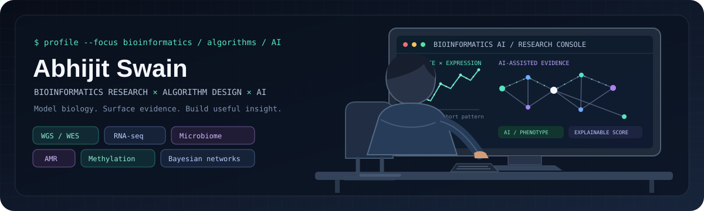

  

  <strong>Bioinformatics research · Algorithm development · AI for genomics</strong> 
  <a href="https://abhijitswain.linklee.in/">Portfolio</a> ·
  <a href="https://linkedin.com/in/abhijit-swain">LinkedIn</a> ·
  <a href="mailto:abhijitswain148@gmail.com">Email</a>

## About

I’m a Senior Bioinformatician at **Genomiki Solutions Pvt. Ltd.** My work spans clinical genomics and computational biology, from rare disease, newborn and carrier screening to oncology and multi-omics research.

I’m interested in the **algorithms behind the analysis**: how biological signals are represented, relationships are inferred, evidence is combined, and uncertainty is made visible. I work across **WGS, WES, RNA-seq, microbiome, antimicrobial resistance (AMR), and DNA methylation**, alongside other genomics and omics questions.

## Research areas & methods

- **Genomic interpretation:** variant relevance and evidence scoring, inheritance-aware analysis, phenotype matching, and clinical evidence review.
- **Transcriptomics:** RNA-seq differential expression, functional enrichment, and gene-expression pattern analysis.
- **Network biology:** gene co-expression networks, module analysis, and Bayesian network modeling.
- **Microbiome & AMR:** microbiome composition and diversity interpretation, resistance-related analysis, and clear reporting.
- **Cancer genomics:** somatic variant evidence, actionability, pharmacogenomics, and clinical-trial matching.
- **Epigenomics:** DNA methylation analysis and integration with broader biological questions.

## AI in bioinformatics

I build AI-assisted workflows around domain-specific evidence rather than treating a model response as the result:

- LLM-assisted phenotype matching and literature consistency checks for variant relevance.
- Rule-based scoring for structured evidence such as consequence, inheritance, frequency, and prior classifications.
- Local-model and assistant prototypes for bringing bioinformatics questions and workflows into interactive applications.
- Evidence, score breakdowns, and review flags that help people inspect how a result was produced.

## Selected project work

Some current projects live in private repositories, so I’m describing the work here without exposing private code, repository links, or study data.

- **Variant relevance and prioritization:** combine variant-level evidence, inheritance, population frequency, disease associations, phenotype similarity, and literature into an inspectable ranking.
- **Cancer variant interpretation:** bring together ACMG/AMP classification, AMP/ASCO/CAP-style tiers, tumor evidence, pharmacogenomics, and trial matching.
- **RNA-seq and network analysis:** move from expression data through differential expression and enrichment to co-expression modules and Bayesian relationships.
- **Microbiome interpretation and reporting:** turn composition, diversity, pathogen, and resistance signals into structured summaries.
- **Clinical and multi-omics workflows:** develop analysis and reporting approaches across WGS/WES, family screening, oncology, methylation, and related research.

## Background

I hold an **MSc in Bioinformatics from Chandigarh University**. For my six-month dissertation at **CSIR–IHBT**, I studied gene co-expression and Bayesian network construction in *Arabidopsis thaliana*.

I also work on bioinformatics portals and research products, collaborating with clinicians, researchers, and software teams to make complex analysis useful and reviewable.

---

  Interested in thoughtful collaborations across computational biology, clinical genomics, and AI.

